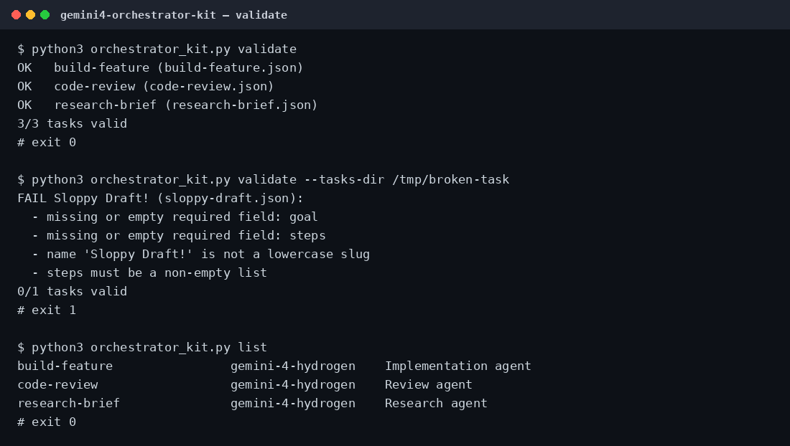

# gemini4-orchestrator-kit



**Validate all three Orchestrator task templates in a median 0.057 seconds — and catch the missing-goal, bad-slug task before it wastes a multi-agent run on Gemini 4 Neon, where every token is billed ($3 input / $15 output per 1M tokens, no free tier).**

Ready-to-use task templates for **Gemini 4 Hydrogen** in Google Antigravity's **Orchestrator** (multi-agent) mode — plus a tiny stdlib-only validator so a bad template never reaches the model. A real run takes a median **0.057 s** (7 runs, measured 2026-11-20 on this machine) — faster than re-reading one template by hand. No API key, no network, no pip installs.

## Why now

- **Gemini 4 Neon went generally available 2026-11-18** — the newest member of the Gemini 4 family, model ID `gemini-4-neon`, and currently **#1 on the Models Engineering Index** (HN buzz, 2026-11-20). Everyone is about to throw multi-agent work at it.
- **The price is the story — there is no free tier.** Neon bills every token, thinking tokens included: **$3 input / $15 output per 1M tokens**. A vague Orchestrator task doesn't just under-perform — it burns a billed multi-agent run and you pay for the wandering.
- **Orchestrator tasks are just structured prompts, and a bad one fails silently.** A missing goal, a vague step, or a typo'd model name wastes the whole run — and you only find out after the agents have already spent your tokens. This kit checks the template *before* you paste it in.
- **Templates are prompts, not API calls.** Nothing here calls Google, so the kit itself costs $0. Swap the `"model"` field to `gemini-4-neon` to run a template on Neon — the schema and validator don't care which Gemini 4 model you name.

Sources: [Google blog — Introducing Gemini 4 Neon, 2026-11-18](https://blog.google/innovation-and-ai/models-and-research/gemini-models/introducing-gemini-4-neon/) · [Gemini API pricing](https://ai.google.dev/gemini-api/docs/pricing) · [Google Antigravity](https://antigravity.google/)

## Quick start (30 seconds)

```bash
git clone https://github.com/Mahgal/gemini4-orchestrator-kit.git
cd gemini4-orchestrator-kit
python3 orchestrator_kit.py validate
python3 orchestrator_kit.py render research-brief
```

No pip installs, no dependencies — Python 3 only. Verified from a clean copy (fresh checkout in `/tmp`, 2026-11-20): `validate` exits 0, `render` works, and the full test suite passes, 9/9, exit 0.

## Example output

Real output of `validate`, a failing task, and `list` (captured verbatim to `demo.txt`; re-runs reproduce it byte-for-byte, sha256 `b393adf25cc7356eca5718d27e4e6eadfd393f6f50b433df4b3c869852c083d1`):

```
$ python3 orchestrator_kit.py validate
OK   build-feature (build-feature.json)
OK   code-review (code-review.json)
OK   research-brief (research-brief.json)
3/3 tasks valid
# exit 0

$ python3 orchestrator_kit.py validate --tasks-dir /tmp/broken-task
FAIL Sloppy Draft! (sloppy-draft.json):
  - missing or empty required field: goal
  - missing or empty required field: steps
  - name 'Sloppy Draft!' is not a lowercase slug
  - steps must be a non-empty list
0/1 tasks valid
# exit 1

$ python3 orchestrator_kit.py list
build-feature                gemini-4-hydrogen    Implementation agent
code-review                  gemini-4-hydrogen    Review agent
research-brief               gemini-4-hydrogen    Research agent
# exit 0
```

The failing task is a real validator run against a genuinely broken file (missing `goal`, empty `steps`, non-slug name) — not a staged screenshot. A bad template fails loudly here instead of silently under-performing inside Antigravity.

## What's inside

| Task | Role | What it does |
|---|---|---|
| `tasks/research-brief.json` | Research agent | Sourced, one-page research brief with claims backed by links |
| `tasks/build-feature.json` | Implementation agent | Implement one small feature, tests first, no scope creep |
| `tasks/code-review.json` | Review agent | Severity-ordered PR review with a one-paragraph verdict |

`orchestrator_kit.py` — `validate` / `list` / `render` (stdlib only). The validator checks: all required fields present and non-empty (`name`, `model`, `role`, `goal`, `steps`), `name` is a lowercase slug, `steps` is a non-empty list of non-empty strings, and optional fields (`inputs`, `outputs`, `guardrails`) are lists when present. Invalid JSON is reported as a failure, not a crash.

## Write your own task

Copy any file in `tasks/`, keep the `name` a lowercase slug, and keep `goal` to one sentence. Run `validate` — a task with a missing `goal` or an empty `steps` list fails loudly instead of silently under-performing. To target Neon instead of Hydrogen, change only the `"model"` field to `gemini-4-neon` and re-run `validate`.

## Tests

Stdlib `unittest` only — no pytest, no network:

```bash
python3 -m unittest discover -s tests
```

9 tests, all passing (exit 0), covering: bundled tasks validate 3/3, bad task fails (bad slug + missing fields), empty directory fails, invalid JSON fails, optional field must be a list, render contains goal and steps, render of an unknown task fails, render of an invalid task fails, and list shows all three tasks.

## Scope and honesty

- Templates are prompts, not API calls — no key, no cost, no network. This kit never calls Google and cannot spend your money.
- The validator checks structure, not quality: a task can pass validation and still be a vague prompt. The guardrails in each template (e.g. "never invent a source") are instructions to the model, not things this tool can enforce.
- The model name follows the Gemini 4 Hydrogen announcement (Nov 2026); the bundled templates name `gemini-4-hydrogen`. Neon pricing and GA date are as published 2026-11-18/19 — if Google changes Neon pricing, the numbers above go stale, so check the pricing page linked above before budgeting a run.
- The 0.057 s median is this machine, 7 runs, 2026-11-20 — your machine will differ slightly, but the order of magnitude (tens of milliseconds) is the point: validation is effectively free.
